# Restaurant POS

A touchscreen point-of-sale system for cafés and restaurants in Malaysia: dine-in tables, takeaway and delivery orders, SST, cash/card/e-wallet payments, receipts and kitchen tickets.
Built with Python, Tkinter and SQLite. It runs offline on one PC, and needs no pip installs.

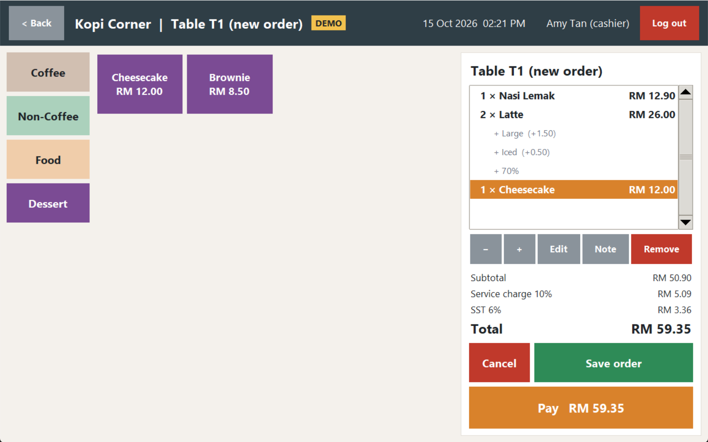

## Features

**At the counter**
- Staff log in by tapping their name and typing a 4-digit PIN. An on-screen keyboard means no physical keyboard is needed.
- **Table map** shows free and occupied tables, time seated and bill so far. Also takeaway, and delivery orders (GrabFood, foodpanda, ShopeeFood, phone).
- Add-ons with rules (e.g. *Size: pick 1*, *Extras: up to 2*), notes per item, and orders you can keep adding to.
- **Checkout:** quick cash buttons and change, card and e-wallet (reference code required), and delivery-app payments kept separate from the cash drawer.
- **Printing:** receipts, bills and kitchen tickets on 80mm/58mm ESC/POS thermal printers (LAN or USB). A virtual printer saves PDFs instead, so it works without a printer.

**Made for Malaysia**
- SST and service charge, with options for dine-in only and tax on the service charge.
- 5-sen rounding for cash bills.
- SST registration number on receipts; delivery platforms used in Malaysia.

**Controls against mistakes and fraud**
- **Voids** need a reason and an admin's password. Voided orders are kept and shown in red, never deleted.
- **Discounts** above a set limit (20% by default) need an admin's password.
- Card and e-wallet reference codes allow end-of-day matching with the bank. Reprinted receipts are marked **COPY**.
- An audit log records logins, voids, discounts, payments and reprints. PINs and admin approvals lock after 5 wrong tries.

**Under the hood**
- **Layers:** screens (Tkinter), business rules (`services/`, no UI code), and storage (SQLite).
- **Exact money maths:** money is stored as whole cents and percentages as basis points, so there are no floating-point rounding errors.
- **Database upgrades:** numbered, all-or-nothing migrations, so a shop's existing data is kept when the app is updated.
- **Safe sales:** saving and paying happen in one transaction, and a printer problem can never undo a sale.
- **Automated tests** (`unittest`) cover the rules, the database upgrades and printing, including a simulated network printer.

## Screenshots

| | |
|---|---|
| 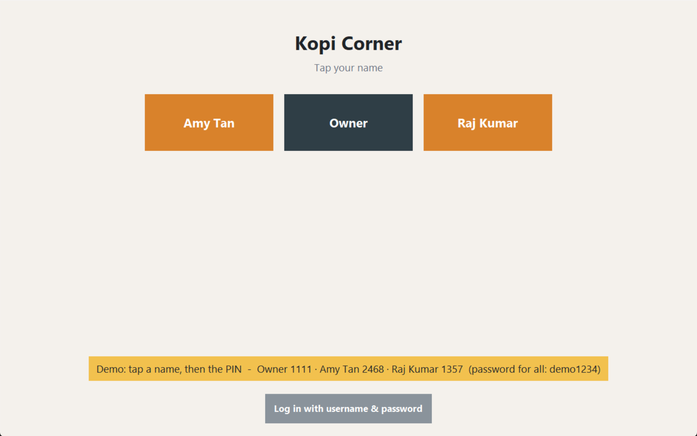 **Login:** tap your name, then PIN | 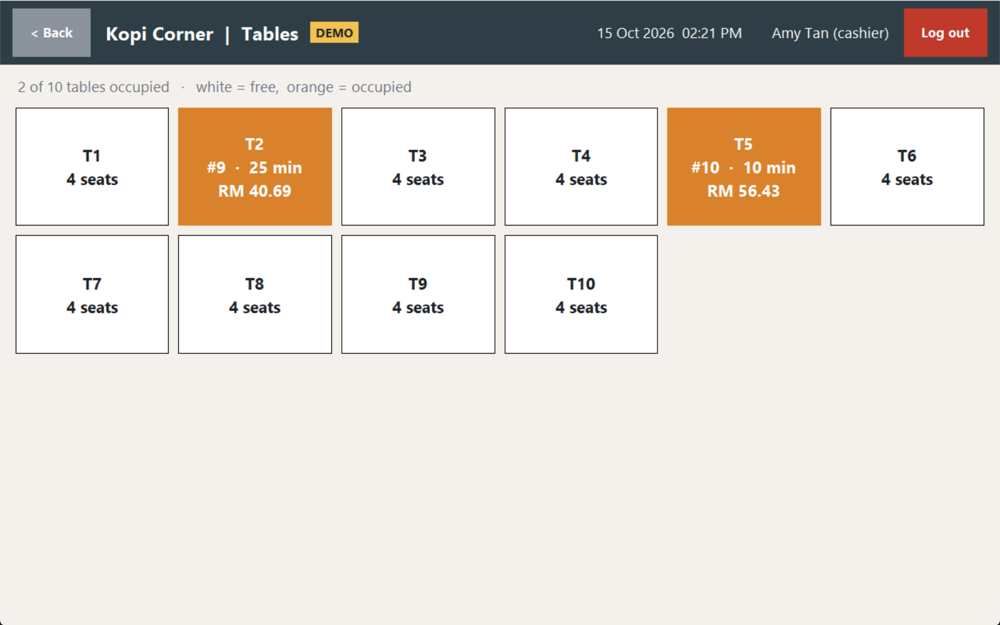 **Table map** |
| 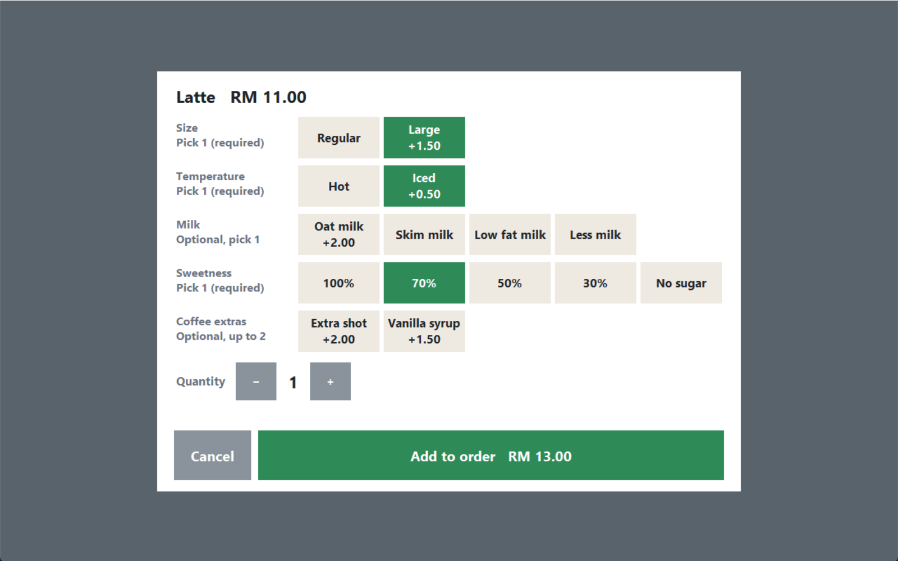 **Add-ons** with rules | 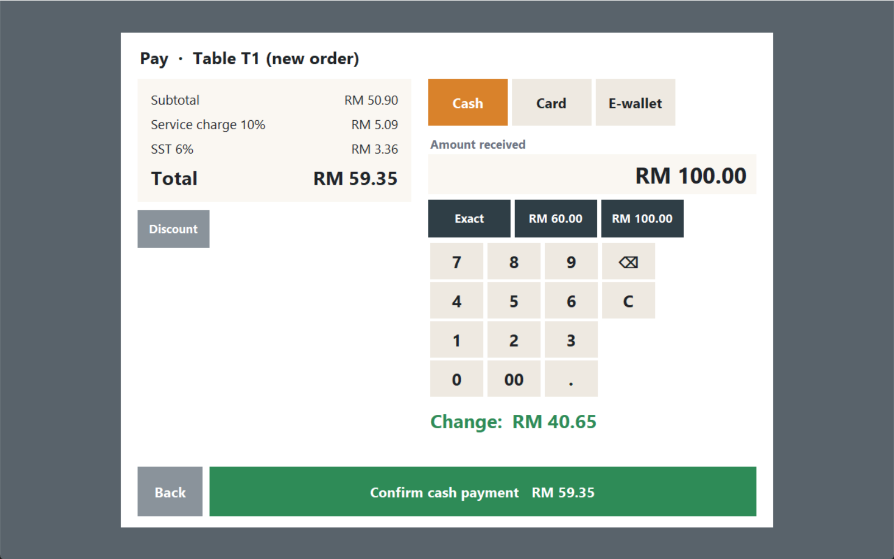 **Cash checkout** |
| 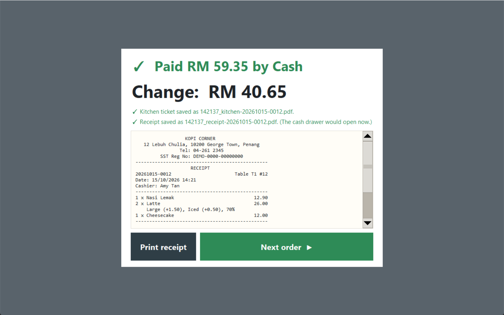 **Paid:** change, receipt, kitchen ticket | 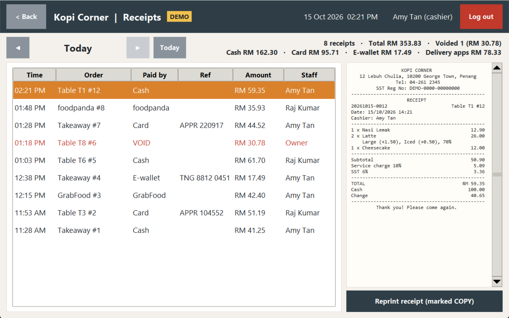 **Day's receipts** and takings |
| 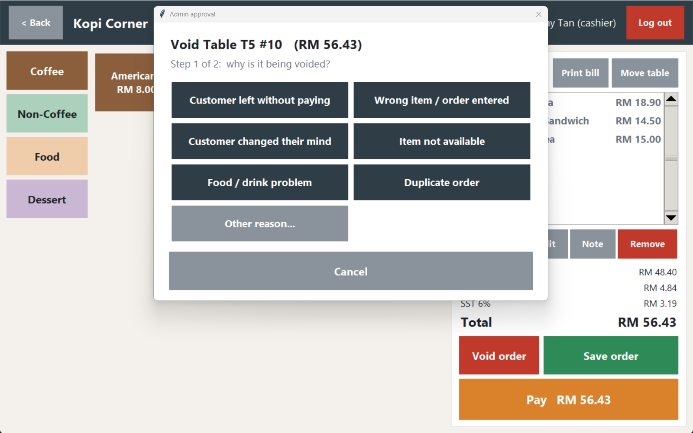 **Void:** reason + admin password | 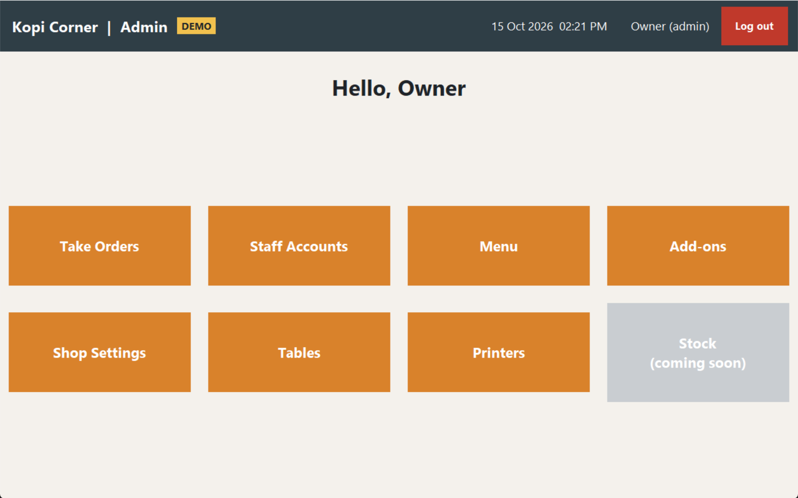 **Admin** |
| 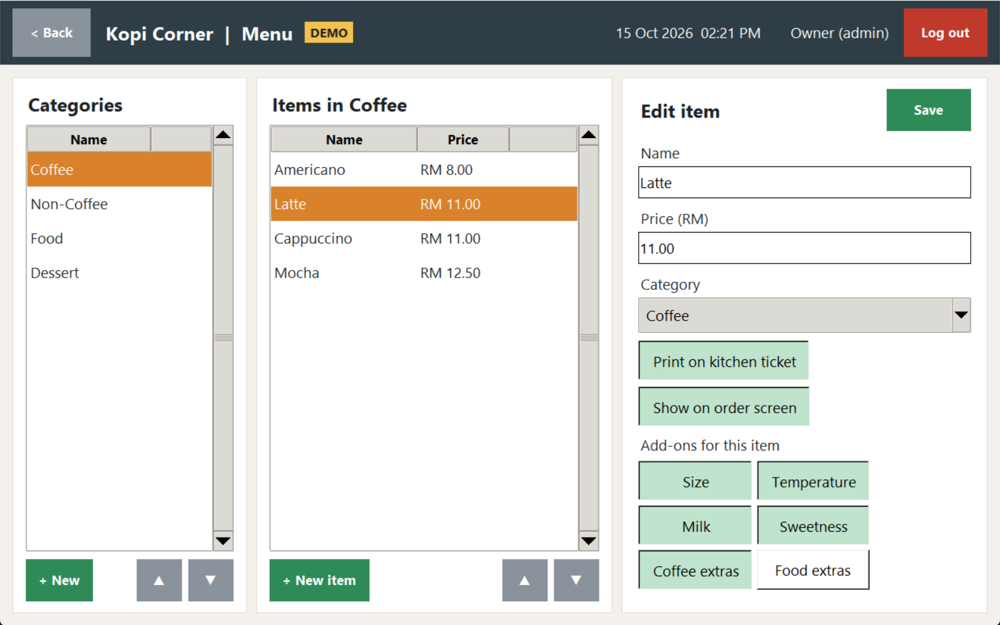 **Menu editor** | 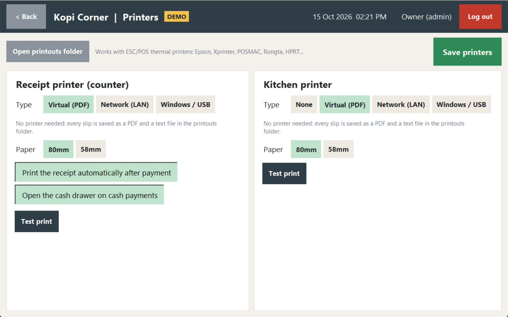 **Printer setup** |

Sample printouts from the virtual printer: [receipt (PDF)](docs/sample-receipt.pdf) · [kitchen ticket (PDF)](docs/sample-kitchen-ticket.pdf)

## Try it

You need Python 3.11+ (from python.org; it includes Tkinter). Built and tested on Windows.

```
py main.py --demo
```

The **demo** opens a sample café with menu, tables, staff and today's orders. It uses its own database in `data/demo/`.
Demo logins (tap a name, then the PIN): **Owner 1111**, **Amy Tan 2468**, **Raj Kumar 1357**. The password for all is `demo1234`.

For real use, run `py main.py`. The first run asks you to create the owner's account. Press **F11** for full screen.

In VS Code: open this folder and press **F5** ("Run Restaurant POS" or "Run demo"). Always start `main.py`; the other files are parts of the app.

Run the tests:

```
py -m unittest discover tests -v
```

## Project layout

| File | Job |
|---|---|
| `main.py` | Starts the app and switches between screens. Also blocks cashiers from admin screens. |
| `config.py` | File paths and app constants (delivery platforms, which are apps, void reasons) |
| `database/schema.sql` | Database tables (version 1) |
| `database/db.py` | Opens the database, upgrades it step by step (migrations), stores settings, writes the audit log |
| `services/auth.py` | Password hashing, login, staff accounts |
| `services/menu.py` | Rules for categories, items and add-ons, plus the sample menu |
| `services/settings.py` | Loads and checks shop settings |
| `services/pricing.py` | Bill maths: service charge, tax, cash rounding |
| `services/formats.py` | Turns "12.50" into 1250 cents and back |
| `services/orders.py` | Cart lines, saving and reopening orders, moving tables, voids (reason + admin approval) |
| `services/tables.py` | Dining tables and the live table map |
| `services/checkout.py` | Discounts (big ones need admin approval), cash rounding, taking payment (save + pay in one step) |
| `services/receipts.py` | Receipts, bills and kitchen tickets as styled lines; the day's receipts |
| `services/printing.py` | Printer settings, virtual/LAN/Windows printing, what prints when |
| `services/escpos.py` | Turns slips into ESC/POS printer commands |
| `services/pdf.py` | Tiny PDF writer for the virtual printer |
| `services/demo.py` | Demo mode: fills a separate database with a sample café |
| `ui/theme.py` | Colours, fonts, big touch-friendly buttons and toggles |
| `ui/keyboard.py` | On-screen keyboard and number pad |
| `ui/dialogs.py` | Pop-up questions that work with the on-screen keyboard |
| `ui/editor.py` | Shared "list + edit form" building blocks |
| `ui/header.py` | Top bar with shop name, clock, user and logout |
| `ui/pinpad.py` | Big number pad for PINs |
| `ui/setup_page.py`, `ui/login_page.py` | First-run setup; login (tap name + PIN, or username + password) |
| `ui/order_page.py` | The order screen and the add-ons picker |
| `ui/open_orders_page.py` | Saved orders that aren't paid yet |
| `ui/tables_page.py` | Cashier's table map (free / occupied) |
| `ui/tables_admin_page.py` | Admin: add, rename, reorder and hide tables |
| `ui/checkout_panel.py` | The Pay screen: bill, discount, cash / card / e-wallet (reference required) / delivery app, change |
| `ui/approval.py` | "Admin approval" pop-ups: voids (reason + password) and big discounts (password) |
| `ui/printers_page.py` | Admin: receipt and kitchen printer settings, test print |
| `ui/receipts_page.py` | A day's receipts, takings by payment method, reprint (marked COPY) |
| `ui/receipt_view.py` | Shows receipt text like the printed slip |
| `ui/home_pages.py` | Admin dashboard and cashier screen |
| `ui/staff_page.py` | Staff accounts |
| `ui/menu_page.py` | Categories and menu items |
| `ui/addons_page.py` | Add-on groups and options |
| `ui/settings_page.py` | Receipt details, tax, service charge, discount rules |
| `tests/` | Automatic tests |

The shop's data is stored in `data/pos.db`, which is created automatically. `data/` is never uploaded to GitHub.

## Printing

Set up in **Admin → Printers**, separately for the receipt printer and the kitchen printer:

- **Virtual (PDF)** (default): no printer needed. Every slip is saved as a PDF and a text file in `data/printouts/<date>/`.
- **Network (LAN)**: a thermal printer on the shop network, reached by its IP address (port 9100).
- **Windows / USB**: a printer installed in Windows. The app sends it raw ESC/POS commands.

Works with ESC/POS thermal printers, which covers most printers sold in Malaysia (Epson TM-T82/TM-m30, Xprinter, POSMAC, Rongta, HPRT). Paper: 80mm (48 characters per line) or 58mm (32).

What prints: kitchen tickets when an order is saved or paid (items switched off for the kitchen are skipped), kitchen VOID tickets, the receipt after payment (opens the cash drawer for cash), the bill on request, and reprints marked COPY. If a printer fails, the sale is still saved and a copy of the slip is kept as a file.

## Roadmap

- [x] **Phase 1 Foundation** - Database, login, admin/cashier roles, staff accounts
- [x] **Phase 2 Menu admin** - Categories, menu items, add-ons, shop settings (SST, service charge), on-screen keyboard
- [x] **PIN login** - Tap your name, enter a 4-digit PIN (locks for 60 s after 5 wrong tries)
- [x] **Phase 3 Order screen** - Takeaway/delivery: tap items, add-ons, cart, save, open orders
- [x] **Phase 4 Tables** - Table map, open dine-in orders you can add to later, move table
- [x] **Phase 5 Checkout** - Discounts, SST, service charge, cash/card/e-wallet/delivery app, cash rounding, receipts
- [x] **Controls** - Card/e-wallet reference required; voids need a reason + admin password; discounts above 20% need an admin password
- [x] **Phase 6 Printing** - Receipts, bills, kitchen tickets, cash drawer; virtual (PDF), LAN or Windows/USB ESC/POS printers
- [ ] **Phase 7 Stock** - Stock goes down on sale, low-stock warning, restock
- [ ] **Phase 8 Safety** - Daily backup, refunds with admin approval, audit log screen
- [ ] **Version 2** - Sales reports, split bill, Chinese characters on printouts

## Author

Built by [kshien67](https://github.com/kshien67). Available for freelance work on POS and business software.
